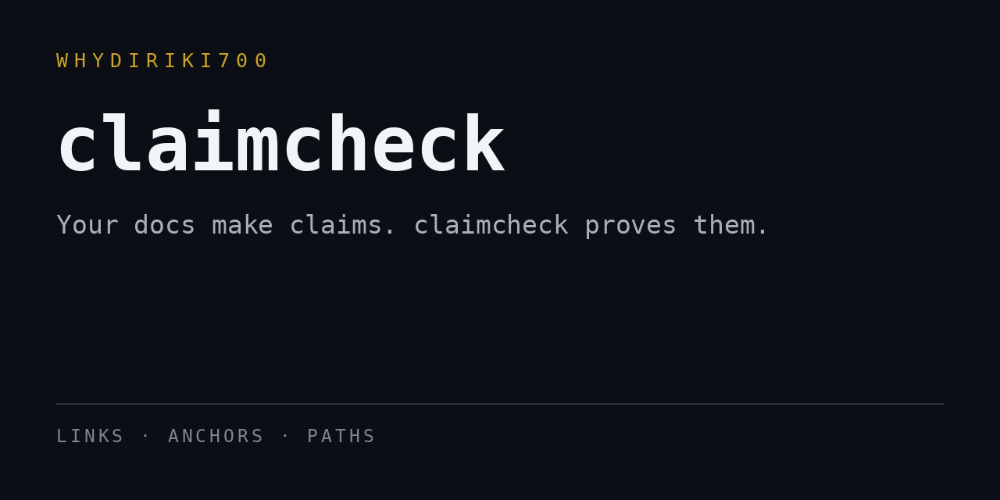

# claimcheck

Your docs make claims. claimcheck proves them. A zero dependency checker that reads a repository's Markdown and verifies what it says against what is actually on disk: linked files must exist, anchors must match real headings, and file paths quoted in inline code must be real paths.

## Why

Documentation rots quietly. A README points at a guide that was renamed, an anchor outlives the heading it named, a quickstart tells readers to edit a file that moved months ago. Nobody notices, because nothing ever checks. claimcheck is the check: run it before you publish, or in CI, and broken claims fail loudly instead of misleading readers.

## What it checks

- **Relative links** such as `[guide](docs/guide.md)`: the target file must exist.
- **Anchors** such as `#install-steps`, in the same file or in a linked Markdown file: a heading must slugify to that anchor, using GitHub's rules.
- **Inline code paths** such as `` `claimcheck.py` ``: the path must exist, resolved from the repository root or from the Markdown file's folder.

External URLs, mail links, absolute machine paths, and tokens with glob or placeholder characters are ignored by design. claimcheck judges only claims a repository can keep.

## Usage

```bash
python -m claimcheck                 # check every .md file under the current directory
python -m claimcheck README.md       # check specific files
python -m claimcheck --root ../repo  # check another repository
python -m claimcheck --json          # machine readable findings
```

## Example output

```text
README.md:14  missing-file  docs/missing.md  (linked file does not exist)
docs/guide.md:3  missing-anchor  #setup  (no heading in this file matches the anchor)
README.md:22  missing-path  src/ghost.py  (path mentioned in inline code does not exist)

3 broken claim(s).
```

Exit code is 1 when any claim is broken, 0 when every claim checks out, so it drops straight into a CI step or a pre-push hook.

## Requirements

Python 3.8 or newer. No packages to install.

## License

MIT. See `LICENSE`.
